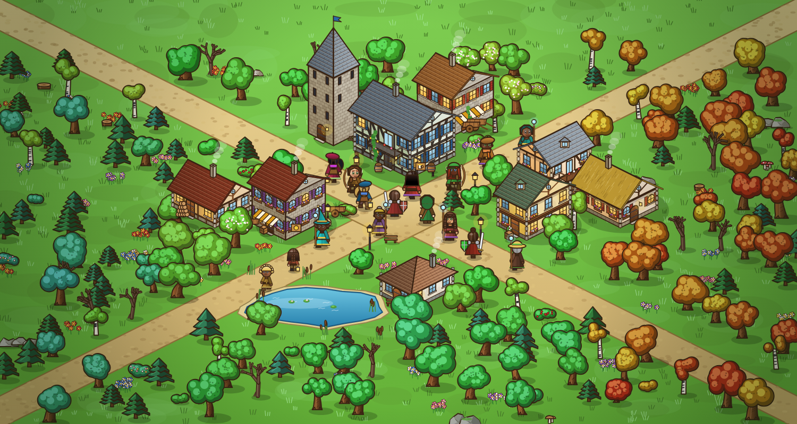

# Arena Iso (robocza nazwa Game2)

Izometryczna taktyczna gra turowa w stylu Dofusa. Osobny projekt, nie część Natalis. Eksperyment na czas testów Natalis.

## Stan
Gotowa jest warstwa grafiki. Gry jeszcze nie ma: brak siatki logicznej, ruchu i tur.

| Co | Gdzie | Co umie |
|---|---|---|
| Budynki | `src/art/buildings.js` | 6 rodzajów (chata, kamienica, karczma, sklep, wieża, gospodarstwo), losowe materiały, dachy, balkony, markizy, szyldy |
| Postacie | `src/art/characters.js` | 7 ról, fryzury, stroje, broń, 4 kierunki, chód w klatkach |
| Przyroda | `src/art/nature.js` | dąb, sosna, brzoza, martwe drzewo, krzewy, skały, kwiaty, grzyby, staw, drogi, 5 biomów |
| Rekwizyty | `src/art/props.js` | beczka, skrzynia, stos kłód, ławka, bela siana, latarnia, wóz |

Wszystko rysuje kod, bez plików graficznych. Każdy obiekt ma ziarno, więc ta sama liczba daje ten sam obiekt, a inna liczba inny.



## Uruchomienie
```
npm test          # testy jednostkowe (Node 22, bez zależności)
npm start         # podgląd grafiki na http://127.0.0.1:8080/
npm i && npm run shots   # zrzuty do docs/podglad (Playwright)
```

## Plan
1. Siatka logiczna i rzut izometryczny (współrzędne siatka <-> ekran, test odwracalności).
2. Ruch po kaflach: A*, punkty ruchu, przeszkody.
3. Tury: kolejka, PA/PM, jeden czar z zasięgiem i linią widzenia.
4. Jedna grywalna arena. Dopiero wtedy decyzja, czy iść dalej.
5. Animacje ataku i trafienia (dziś jest tylko chód), cache sprite'ów do offscreen canvasów.

Nieprzetestowane: wydajność rysowania wielu obiektów w czasie rzeczywistym. Generatory są drogie, więc wynik trzeba cache'ować, zamiast rysować od nowa co klatkę.
